<a href="https://www.m1d0.com"><picture><source media="(max-width: 640px)" srcset="./assets/banner-mobile.svg" /></picture></a>

M1D0 Technologies is a founder-led boutique business and digital transformation firm working across business strategy, operations and technology through long-term partnerships.

## How M1D0 works

<picture><source media="(prefers-color-scheme: dark) and (max-width: 640px)" srcset="./assets/how-mobile-dark.svg" /><source media="(max-width: 640px)" srcset="./assets/how-mobile-light.svg" /><source media="(prefers-color-scheme: dark)" srcset="./assets/how-dark.svg" /></picture>

Work begins with understanding the business itself—its purpose and values, what it offers, whom it serves and how it operates—before determining what to optimize and modernize. From that understanding, M1D0 sets the direction for business transformation, aligning expertise and resources to strengthen operations, decision-making, customer relationships and the capacity to adapt and grow.

Technology follows that direction, with systems and capabilities selected to support the business's priorities and redesigned operations—connecting people, processes, systems and information rather than dictating how the business works. AI and automation are introduced only where they serve a clear business purpose—not as goals in themselves.

<picture><source media="(prefers-color-scheme: dark) and (max-width: 640px)" srcset="./assets/founder-mobile-dark.svg" /><source media="(max-width: 640px)" srcset="./assets/founder-mobile-light.svg" /><source media="(prefers-color-scheme: dark)" srcset="./assets/founder-dark.svg" /></picture>

Direct founder involvement maintains strategic direction, quality and accountability from planning through implementation, integration and adoption. Specialist expertise is coordinated under that direction, informed by firsthand experience of the commercial decisions and operational realities of running businesses. As priorities evolve, M1D0 remains involved in refining strategy, strengthening operations and developing the capabilities needed to pursue opportunities and grow with greater control.

## Specialties

<picture><source media="(prefers-color-scheme: dark) and (max-width: 640px)" srcset="./assets/specialties-mobile-dark.svg" /><source media="(max-width: 640px)" srcset="./assets/specialties-mobile-light.svg" /><source media="(prefers-color-scheme: dark)" srcset="./assets/specialties-dark.svg" /></picture>

## Connected through Dahhan Enterprises

As one of the businesses connected through Dahhan Enterprises, M1D0 leads the transformation and long-term development of Dahhan Industries and Miss Dantella—across operations, commerce and supporting systems.

<picture><source media="(prefers-color-scheme: dark) and (max-width: 640px)" srcset="./assets/businesses-mobile-dark.svg" /><source media="(max-width: 640px)" srcset="./assets/businesses-mobile-light.svg" /><source media="(prefers-color-scheme: dark)" srcset="./assets/businesses-dark.svg" /></picture>

<a href="https://www.dahhanenterprises.com"><picture><source media="(max-width: 640px)" srcset="./assets/card-de-mobile.svg" /></picture></a>

<b>Overview</b> · <a href="https://www.dahhanenterprises.com">dahhanenterprises.com</a> · <a href="https://www.linkedin.com/company/dahhan-enterprises/">LinkedIn</a>

With commercial roots tracing back to Dahhan in 1990, Dahhan Enterprises serves as the international-facing corporate identity connecting businesses across manufacturing, trade, commerce and technology.

That heritage began in industrial textiles and wholesale, where understanding products and markets, securing reliable supply, coordinating production and building lasting commercial relationships formed the foundation of the business. These principles continue to shape its development across different industries and markets.

Today, Dahhan Enterprises brings together three distinct business identities: Dahhan Industries, focused on industrial textiles, manufacturing and B2B supply; Miss Dantella, specializing in lingerie, nightwear, wholesale and ecommerce; and M1D0 Technologies, focused on business and digital transformation, technology strategy, enterprise architecture, automation and AI.

Each business maintains its own specialization, market focus and commercial activities. Dahhan Enterprises provides a unified corporate presence and a central point of reference, connecting customers, suppliers and partners with the business best suited to their needs.

Across these businesses, the commitment remains consistent: build trusted relationships, maintain dependable operations, pursue long-term development and apply technology where it creates meaningful business value.

<a href="https://www.dahhanindustries.com"><picture><source media="(max-width: 640px)" srcset="./assets/card-di-mobile.svg" /></picture></a>

<b>Overview</b> · <a href="https://www.dahhanindustries.com">dahhanindustries.com</a> · <a href="https://www.linkedin.com/company/dahhan-industries/">LinkedIn</a>

Dahhan Industries specializes in fabrics, lace, elastics and textile accessories, supplying apparel manufacturers, lingerie producers and wholesale buyers. Rooted in the Dahhan business established in 1990, the company has particular expertise in materials for lingerie and women's underwear, while serving a broader range of textile and apparel applications.

Its capabilities span textile manufacturing, sourcing, international trade and B2B wholesale. Combining product expertise with manufacturing and supply coordination, Dahhan Industries supports the material requirements of apparel producers and commercial partners.

Within the wider Dahhan business represented internationally by Dahhan Enterprises, Dahhan Industries also supplies materials used in Miss Dantella's lingerie and nightwear collections. This relationship connects textile supply with finished-apparel production, while each business maintains its own specialization, market focus and commercial identity.

<a href="https://www.missdantella.com"><picture><source media="(max-width: 640px)" srcset="./assets/card-md-mobile.svg" /></picture></a>

<b>Overview</b> · <a href="https://www.missdantella.com">missdantella.com</a> · <a href="https://www.linkedin.com/company/missdantella/">LinkedIn</a>

Miss Dantella develops women's lingerie, underwear and nightwear collections for wholesale partners and individual customers. Bringing together product development, apparel production and commerce, the brand serves both B2B wholesale and B2C retail markets.

Building on Dahhan's earlier lingerie wholesale business, Miss Dantella established its own identity in 2000 and expanded into consumer markets. Its collections incorporate fabrics, lace, elastics and accessories supplied by Dahhan Industries, connecting textile expertise with finished apparel.

Within the wider Dahhan business represented internationally by Dahhan Enterprises, Miss Dantella maintains its own brand identity, product direction and commercial relationships, with a continued focus on developing its collections, wholesale partnerships and customer experience.

## The measure of progress

<picture><source media="(prefers-color-scheme: dark) and (max-width: 640px)" srcset="./assets/progress-mobile-dark.svg" /><source media="(max-width: 640px)" srcset="./assets/progress-mobile-light.svg" /><source media="(prefers-color-scheme: dark)" srcset="./assets/progress-dark.svg" /></picture>

Progress is measured by the strength of the business itself: clearer ownership, stronger internal capabilities and dependable operations that evolve with its needs. M1D0 is selective in its partnerships, working with businesses that value sound judgment, decisive action, shared accountability and sustained development.

## Showcase repositories

Each repository presents one business. They hold documentation and showcase material only; product source code is kept private.

<a href="https://github.com/M1D0-Technologies/m1d0-technologies"><picture><source media="(prefers-color-scheme: dark) and (max-width: 640px)" srcset="./assets/tiles/repo-m1d0-technologies-mob-dark.svg" /><source media="(max-width: 640px)" srcset="./assets/tiles/repo-m1d0-technologies-mob-light.svg" /><source media="(prefers-color-scheme: dark)" srcset="./assets/tiles/repo-m1d0-technologies-desk-dark.svg" /></picture></a><a href="https://github.com/M1D0-Technologies/platform-engineering"><picture><source media="(prefers-color-scheme: dark) and (max-width: 640px)" srcset="./assets/tiles/repo-platform-engineering-mob-dark.svg" /><source media="(max-width: 640px)" srcset="./assets/tiles/repo-platform-engineering-mob-light.svg" /><source media="(prefers-color-scheme: dark)" srcset="./assets/tiles/repo-platform-engineering-desk-dark.svg" /></picture></a>

<a href="https://github.com/M1D0-Technologies/dahhan-enterprises"><picture><source media="(prefers-color-scheme: dark) and (max-width: 640px)" srcset="./assets/tiles/repo-dahhan-enterprises-mob-dark.svg" /><source media="(max-width: 640px)" srcset="./assets/tiles/repo-dahhan-enterprises-mob-light.svg" /><source media="(prefers-color-scheme: dark)" srcset="./assets/tiles/repo-dahhan-enterprises-desk-dark.svg" /></picture></a>

<a href="https://github.com/M1D0-Technologies/dahhan-industries"><picture><source media="(prefers-color-scheme: dark) and (max-width: 640px)" srcset="./assets/tiles/repo-dahhan-industries-mob-dark.svg" /><source media="(max-width: 640px)" srcset="./assets/tiles/repo-dahhan-industries-mob-light.svg" /><source media="(prefers-color-scheme: dark)" srcset="./assets/tiles/repo-dahhan-industries-desk-dark.svg" /></picture></a><a href="https://github.com/M1D0-Technologies/miss-dantella"><picture><source media="(prefers-color-scheme: dark) and (max-width: 640px)" srcset="./assets/tiles/repo-miss-dantella-mob-dark.svg" /><source media="(max-width: 640px)" srcset="./assets/tiles/repo-miss-dantella-mob-light.svg" /><source media="(prefers-color-scheme: dark)" srcset="./assets/tiles/repo-miss-dantella-desk-dark.svg" /></picture></a>

## Get in touch

<a href="https://www.m1d0.com"><picture><source media="(prefers-color-scheme: dark) and (max-width: 640px)" srcset="./assets/tiles/ct-web-mob-dark.svg" /><source media="(max-width: 640px)" srcset="./assets/tiles/ct-web-mob-light.svg" /><source media="(prefers-color-scheme: dark)" srcset="./assets/tiles/ct-web-desk-dark.svg" /></picture></a><a href="https://www.linkedin.com/company/m1d0/"><picture><source media="(prefers-color-scheme: dark) and (max-width: 640px)" srcset="./assets/tiles/ct-li-mob-dark.svg" /><source media="(max-width: 640px)" srcset="./assets/tiles/ct-li-mob-light.svg" /><source media="(prefers-color-scheme: dark)" srcset="./assets/tiles/ct-li-desk-dark.svg" /></picture></a>

<a href="mailto:mahmutdehhan@m1d0.com"><picture><source media="(prefers-color-scheme: dark) and (max-width: 640px)" srcset="./assets/tiles/ct-mail-mob-dark.svg" /><source media="(max-width: 640px)" srcset="./assets/tiles/ct-mail-mob-light.svg" /><source media="(prefers-color-scheme: dark)" srcset="./assets/tiles/ct-mail-desk-dark.svg" /></picture></a><a href="https://www.linkedin.com/in/mahmutdehhan/"><picture><source media="(prefers-color-scheme: dark) and (max-width: 640px)" srcset="./assets/tiles/ct-founder-mob-dark.svg" /><source media="(max-width: 640px)" srcset="./assets/tiles/ct-founder-mob-light.svg" /><source media="(prefers-color-scheme: dark)" srcset="./assets/tiles/ct-founder-desk-dark.svg" /></picture></a>

Business first. Technology second. AI third. © 2026 Dahhan Enterprises LLC. All rights reserved.
